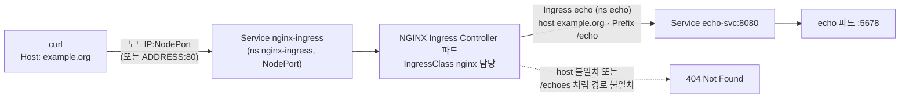
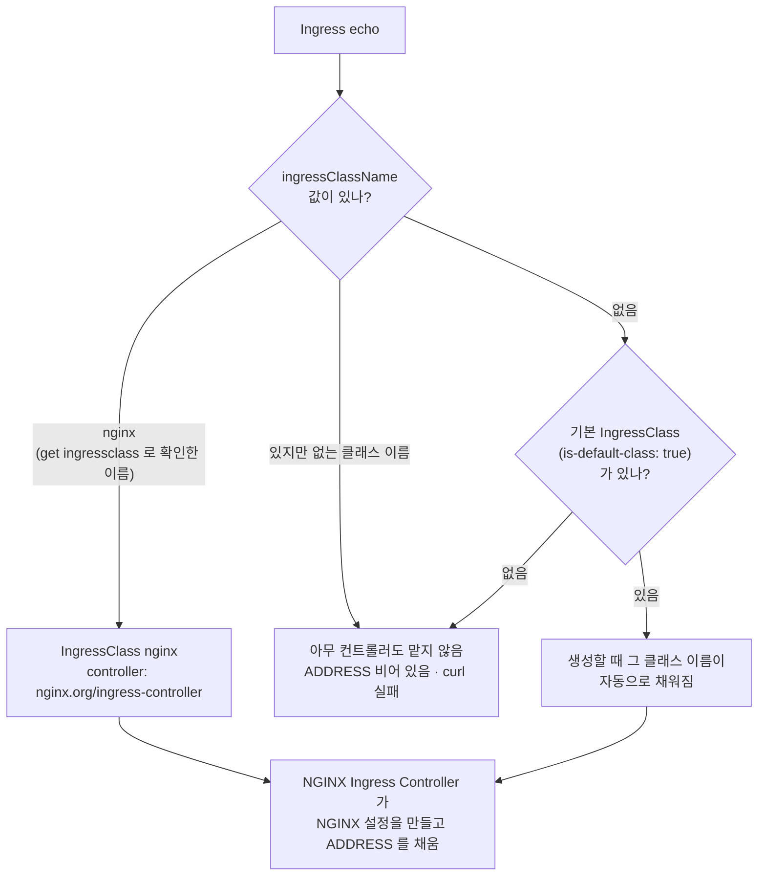

# q09 — Publish a Service with an Ingress · 풀이

← 문제: **[question.md](question.md)**

## 문제 (해석)

`echo` 네임스페이스에는 포트 `8080` 에서 대기하며 어떤 경로든 HTTP `200` 을 돌려주는 Service
`echo-svc` 가 있다. 클러스터에는 Ingress 컨트롤러가 설치되어 있다.

1. 클러스터에 있는 IngressClass의 이름을 찾는다.
2. 이 IngressClass를 쓰는 Ingress `echo` 를 `echo` 네임스페이스에 만든다. 호스트 `example.org`,
   경로 `/echo`(path type `Prefix`)의 요청을 Service `echo-svc` 의 포트 `8080` 으로 보낸다.
3. `Host: example.org` 헤더를 붙여 Ingress 컨트롤러로 `curl` 을 보내, 경로 `/echo` 가 HTTP `200` 을
   돌려주는지 확인한다.

## 모범 풀이

**1) IngressClass 확인**

```bash
kubectl get ingressclass
# NAME    CONTROLLER                     PARAMETERS   AGE
# nginx   nginx.org/ingress-controller   <none>       30d      ← 예시. 이름은 클러스터마다 다르다
```

Ingress NGINX 컨트롤러(kubernetes/ingress-nginx)는 2026년 3월에 은퇴해 더 이상 수정이 나오지
않습니다. 하지만 Ingress **API** 는 그대로 GA이고 시험 범위에도 있으므로, 클러스터에 실제로 있는
클래스를 그대로 씁니다. 컨트롤러 전용 어노테이션(`nginx.ingress.kubernetes.io/...`)에 기대지 않고
표준 필드만 쓰면 어느 컨트롤러에서나 같게 동작합니다. 후속 표준은 Gateway API(q08)입니다.

**2) Ingress** — 명령형 한 줄. 경로 끝의 `*` 가 `pathType: Prefix` 이고, 없으면 `Exact` 입니다.

```bash
kubectl -n echo create ingress echo --class=nginx \
  --rule='example.org/echo*=echo-svc:8080'
```

같은 결과의 yaml:

```yaml
apiVersion: networking.k8s.io/v1
kind: Ingress
metadata:
  name: echo
  namespace: echo
spec:
  ingressClassName: nginx        # 1)에서 확인한 이름
  rules:
  - host: example.org
    http:
      paths:
      - path: /echo
        pathType: Prefix         # 필수
        backend:
          service:
            name: echo-svc
            port:
              number: 8080       # Service 의 port
```

**`pathType` 은 필수 필드입니다.** `networking.k8s.io/v1` 에서는 기본값이 채워지지 않고
`pathType: Required value` 검증 에러로 거부됩니다. `Prefix` 는 경로 요소 단위 일치라 `/echo`,
`/echo/`, `/echo/a` 는 맞고 `/echoes` 는 맞지 않습니다.

### 트래픽 흐름



1. 클라이언트가 컨트롤러 Service `nginx-ingress` 로 요청을 보냅니다. 이 실습 환경은 NodePort 라 `<노드IP>:<NodePort>` 로
   들어오고, LoadBalancer 가 있는 클러스터라면 Ingress ADDRESS 의 80 포트로 들어옵니다.
2. 요청은 NGINX Ingress Controller 파드에 도착합니다. 이 컨트롤러는 `ingressClassName: nginx` 인 Ingress 만 읽어 NGINX 설정을 만듭니다.
3. NGINX 는 Host 가 `example.org` 인지 본 뒤 경로를 `Prefix /echo` 와 비교합니다. `/echo`, `/echo/a` 는 Service `echo-svc` 포트
   8080으로 가고, Host 가 다르거나 `/echoes` 처럼 경로 요소가 다르면 404를 직접 돌려줍니다.
4. Service `echo-svc` 가 `targetPort` 5678 의 파드로 요청을 넘기고, 응답(200, `echo`)이 같은 길로 돌아옵니다. 경로는 바뀌지 않고 그대로 전달됩니다.

### 어느 컨트롤러가 이 Ingress 를 맡는가



1. Ingress 컨트롤러는 자기 IngressClass 를 가리키는 Ingress 만 읽습니다. 그래서 1)에서 클래스 이름을 먼저 확인하고
   `--class`(`ingressClassName`)에 그대로 넣습니다.
2. 클래스 이름을 틀리게 쓰면 API 서버는 Ingress 를 그대로 받아 줍니다. 에러는 없지만 어떤 컨트롤러도 처리하지 않아
   ADDRESS 가 비어 있고 요청이 닿지 않습니다.
3. `ingressClassName` 을 빼면 기본 IngressClass 가 있을 때만 생성 시점에 그 이름이 채워집니다. 없으면 2와 같은 상태가 됩니다.
   `kubectl -n echo get ingress echo` 의 CLASS 열과 ADDRESS 열로 바로 확인할 수 있습니다.

## 검증

```bash
kubectl -n echo get ingress echo
# NAME   CLASS   HOSTS         ADDRESS         PORTS   AGE
# echo   nginx   example.org   192.168.1.241   80      30s
IP=$(kubectl -n echo get ingress echo -o jsonpath='{.status.loadBalancer.ingress[0].ip}')
curl -s -o /dev/null -w '%{http_code}\n' -H 'Host: example.org' http://$IP/echo   # 200
curl -s -o /dev/null -w '%{http_code}\n' http://$IP/echo                          # 보통 404 — Host 불일치
```

ADDRESS가 비어 있으면 컨트롤러 Service의 NodePort로 보냅니다(`kubectl get svc -A | grep -i ingress`
→ `curl -H 'Host: example.org' http://<노드IP>:<NodePort>/echo`). `/etc/hosts` 에 `example.org` 가
컨트롤러 주소로 등록되어 있다면 `curl http://example.org/echo` 로도 됩니다.

## 오답 원인 / 배운 점

- **왜 틀렸나**:
- **기억할 것**: Ingress v1은 `pathType` 이 필수다. 클래스는 `kubectl get ingressclass` 로 확인해 `ingressClassName`(`--class`)에 넣는다.
- **헷갈리는 지점**: `backend.service.port.number` 는 Service의 port(8080)이지 컨테이너 포트가 아닙니다. `ingressClassName` 을 빼면 기본 IngressClass(`ingressclass.kubernetes.io/is-default-class: "true"`)가 있을 때만 그 클래스가 채워지고, 없으면 보통 어떤 컨트롤러도 처리하지 않아 ADDRESS가 비어 있습니다.

## 참고 문서

- 검색어: `ingress`, `ingress controllers`
- https://kubernetes.io/docs/concepts/services-networking/ingress/
- https://kubernetes.io/docs/concepts/services-networking/ingress-controllers/
- https://kubernetes.io/blog/2025/11/11/ingress-nginx-retirement/

## 복습 기록

| 날짜 | 결과 | 메모 |
|---|---|---|
|  |  |  |
