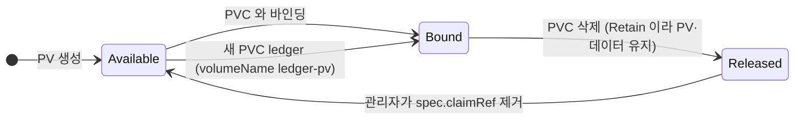
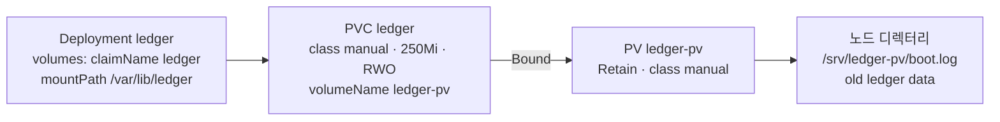

# q11 — Reattach a retained volume to a new Deployment · 풀이

← 문제: **[question.md](question.md)**

## 문제 (해석)

**원문**

> Deployment `ledger` in namespace `finance` and its PVC were deleted by mistake. The data survived on
> PersistentVolume `ledger-pv` (`250Mi`, `ReadWriteOnce`, storageClassName `manual`, reclaim policy
> `Retain`), and an administrator has already made it `Available` again. A copy of the Deployment
> manifest is at `/opt/course/e11/ledger-deploy.yaml`.
>
> 1. Create a PersistentVolumeClaim named `ledger` in namespace `finance` (`ReadWriteOnce`, `250Mi`,
>    storageClassName `manual`) that binds to exactly `ledger-pv`.
> 2. Edit `/opt/course/e11/ledger-deploy.yaml` so that its container mounts PVC `ledger` at
>    `/var/lib/ledger`, then apply the file.
> 3. Confirm that PVC `ledger` is `Bound` to `ledger-pv` and that the `ledger` pod is `Running`.

**해석**

`finance` 네임스페이스의 Deployment `ledger` 와 그 PVC가 실수로 삭제되었다. 데이터는
PersistentVolume `ledger-pv`(`250Mi`, `ReadWriteOnce`, storageClassName `manual`, reclaim policy
`Retain`)에 남아 있고, 관리자가 이미 이 PV를 다시 `Available` 상태로 만들어 두었다. Deployment
매니페스트 사본은 `/opt/course/e11/ledger-deploy.yaml` 에 있다.

1. `finance` 네임스페이스에 정확히 `ledger-pv` 에 바인딩되는 PersistentVolumeClaim `ledger`
   (`ReadWriteOnce`, `250Mi`, storageClassName `manual`)를 만든다.
2. `/opt/course/e11/ledger-deploy.yaml` 을 수정해 컨테이너가 PVC `ledger` 를 `/var/lib/ledger` 에
   마운트하게 한 뒤 적용한다.
3. PVC `ledger` 가 `ledger-pv` 에 `Bound` 이고 `ledger` 파드가 `Running` 인지 확인한다.

## 모범 풀이

**1) PV를 지정한 PVC** — 먼저 `kubectl get pv ledger-pv` 로 `Available`, class `manual` 을 확인합니다.
`spec.volumeName` 이 PVC를 특정 PV에 고정하는 필드입니다.

```yaml
# ledger-pvc.yaml
apiVersion: v1
kind: PersistentVolumeClaim
metadata:
  name: ledger
  namespace: finance
spec:
  storageClassName: manual       # PV 와 같아야 한다
  volumeName: ledger-pv          # 이 PV 에만 바인딩
  accessModes: ["ReadWriteOnce"]
  resources: {requests: {storage: 250Mi}}
```

바인딩 조건은 PV가 `Available`, storageClassName 동일, accessModes 일치, PV 용량 ≥ 요청량입니다.
`storageClassName` 을 빼면 class가 `manual` 과 달라져(기본 StorageClass가 있으면 그 이름이 채워짐) `Pending` 에 머뭅니다.

**2) Deployment 매니페스트** — 주어진 파일(예시)에 `volumeMounts` 와 `volumes` 두 곳을 추가합니다.

```yaml
apiVersion: apps/v1
kind: Deployment
metadata: {name: ledger, namespace: finance}
spec:
  replicas: 1
  selector: {matchLabels: {app: ledger}}
  template:
    metadata: {labels: {app: ledger}}
    spec:
      containers:
      - name: ledger
        image: busybox:1.36
        command: ["sh", "-c", "date >> /var/lib/ledger/boot.log; sleep 3600"]
        volumeMounts:              # ← 추가
        - name: data
          mountPath: /var/lib/ledger
      volumes:                     # ← 추가 (containers 와 같은 들여쓰기)
      - name: data
        persistentVolumeClaim:
          claimName: ledger
```

```bash
kubectl apply -f ledger-pvc.yaml
kubectl apply -f /opt/course/e11/ledger-deploy.yaml
```

**PV가 `Released` 였다면** — `Retain` PV는 PVC가 지워지면 `Released` 가 되고, `spec.claimRef` 에 옛 PVC
정보가 남아 새 PVC와 바인딩되지 않습니다. 이때는 `claimRef` 를 지워 `Available` 로 만듭니다(데이터는 남음).

```bash
kubectl patch pv ledger-pv --type=json -p='[{"op":"remove","path":"/spec/claimRef"}]'
```

### 그림 1 — Retain PV 의 상태 변화



1. 원래 Deployment 의 PVC 가 지워지자 `Retain` 정책 때문에 PV 는 지워지지 않고 `Released` 가 됐습니다. `claimRef` 에 옛 PVC 가 남아 있어서 이 상태로는 어떤 PVC 와도 바인딩되지 않습니다.
2. 문제에서는 관리자가 이미 `claimRef` 를 지워 `Available` 로 돌려놓았습니다. 직접 해야 한다면 `kubectl patch ... remove /spec/claimRef` 가 이 화살표입니다.
3. 새 PVC 는 `volumeName: ledger-pv` 로 이 PV 만 고르고, class·accessModes·용량이 맞으면 `Bound` 가 됩니다.

### 그림 2 — 새 Deployment 가 예전 데이터에 닿는 경로



1. 파드는 PV 를 직접 참조하지 않고 PVC 이름(`claimName`)만 압니다. 그래서 Deployment 에는 PVC `ledger` 를 적습니다.
2. PVC 와 PV 의 `storageClassName` 이 둘 다 `manual` 이어야 이어집니다. PVC 에서 class 를 빼면 기본 클래스 이름이 채워져 연결이 끊깁니다.
3. PV 가 가리키는 노드 디렉터리에 예전 파일이 남아 있으므로, 새 파드의 `/var/lib/ledger` 에서 `boot.log` 를 볼 수 있습니다.

## 검증

```bash
kubectl -n finance get pvc ledger               # STATUS Bound, VOLUME ledger-pv, STORAGECLASS manual
kubectl get pv ledger-pv                        # STATUS Bound, CLAIM finance/ledger
kubectl -n finance get pods -l app=ledger       # Running
kubectl -n finance exec deploy/ledger -- ls /var/lib/ledger    # 예전 파일도 보인다
```

## 오답 원인 / 배운 점

- **왜 틀렸나**:
- **기억할 것**: 특정 PV를 다시 쓰려면 PVC에 `volumeName` 과 같은 `storageClassName` 을 준다. `Released` PV는 `spec.claimRef` 를 지워야 `Available` 이 된다.
- **헷갈리는 지점**: `Retain` 은 "PVC가 지워져도 PV와 데이터를 남긴다"는 뜻이지 "자동으로 다시 쓸 수 있다"는 뜻이 아닙니다. `volumeName` 은 PV를 지정할 뿐이라 class·용량·accessModes가 안 맞으면 여전히 `Pending` 이고, 이유는 `kubectl -n finance describe pvc ledger` 의 이벤트에 나옵니다.

## 참고 문서

- 검색어: `persistent volumes reserving a persistentvolume`
- https://kubernetes.io/docs/concepts/storage/persistent-volumes/
- https://kubernetes.io/docs/tasks/configure-pod-container/configure-persistent-volume-storage/

---

[↑ 문항 목록](../README.md) · [← 문제로](question.md) · [다음 문제 q12 →](../q12_emptydir_memory_sizelimit/question.md)
