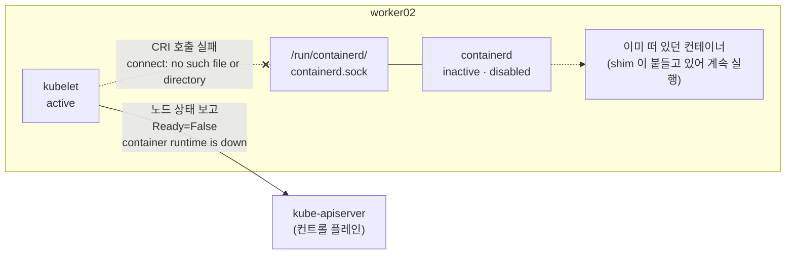

# q14 — Node NotReady because the container runtime is down · 풀이

← 문제: **[question.md](question.md)**

## 문제 (해석)

**원문**

> Node `worker02` of cluster `k8s-c1` is `NotReady`. The kubelet service on `worker02` is running.
>
> 1. On `worker02`, use the kubelet journal to find out why the node is `NotReady`.
> 2. Fix the cause so that the fix also survives a reboot of `worker02`.
> 3. Write the name of the systemd service that caused the problem to `/opt/course/e14/cause.txt`
>    on `worker02`.
> 4. Confirm that `worker02` becomes `Ready`.

**해석**

`k8s-c1` 클러스터의 노드 `worker02` 가 `NotReady` 다. `worker02` 의 kubelet 서비스는 실행 중이다.

1. `worker02` 에서 kubelet journal로 노드가 `NotReady` 인 이유를 찾는다.
2. 원인을 고치되, `worker02` 를 재부팅해도 유지되도록 고친다.
3. 문제를 일으킨 systemd 서비스의 이름을 `worker02` 의 `/opt/course/e14/cause.txt` 에 적는다.
4. `worker02` 가 `Ready` 가 되는지 확인한다.

## 모범 풀이

**1) 들어가기 전에 컨트롤 플레인 쪽에서 한 번** (`k8s-c1`)

```bash
kubectl get nodes                                  # worker02  NotReady
kubectl describe node worker02 | grep -A8 Conditions
# Ready   False   ...   KubeletNotReady   container runtime is down ...      ← 예시
```

`Ready=False` 에 구체적인 message가 있으면 kubelet은 살아서 자기 문제를 보고하는 중입니다. kubelet이
죽었다면 `Unknown` 과 `Kubelet stopped posting node status` 가 보입니다.

**2) 노드에서 kubelet journal**

```bash
ssh worker02
sudo -i
systemctl is-active kubelet                        # active
journalctl -u kubelet -n 30 --no-pager
# ... "Status from runtime service failed" err="rpc error: code = Unavailable desc = connection error:
#     desc = \"transport: Error while dialing: dial unix /run/containerd/containerd.sock:
#     connect: no such file or directory\""                                  ← 예시
```

**kubelet은 컨테이너를 직접 다루지 않고 CRI 소켓으로 containerd에 요청합니다.** 그 소켓에 연결할 수
없다는 것은 containerd가 떠 있지 않다는 뜻입니다.

```bash
systemctl status containerd --no-pager             # Active: inactive (dead)
systemctl is-enabled containerd                    # disabled
```

**3) 수리 — 지금 켜고(start) 부팅 때도 켜지게(enable)**

```bash
systemctl enable --now containerd
systemctl is-active containerd; systemctl is-enabled containerd     # active / enabled
crictl ps                                          # 이 노드의 컨테이너가 다시 보인다
mkdir -p /opt/course/e14
echo containerd > /opt/course/e14/cause.txt
```

`start` 만 하면 지금은 Ready가 되지만 `disabled` 가 그대로라 재부팅하면 같은 장애가 납니다. kubelet은
containerd가 돌아오면 스스로 다시 연결하므로 보통 kubelet 재시작은 필요 없습니다(1분이 지나도
NotReady면 `systemctl restart kubelet`).

### 그림 — kubelet 은 살아 있는데 왜 NotReady 인가



1. kubelet 은 컨테이너를 직접 만들지 않고, CRI 소켓(`containerd.sock`)으로 containerd 에 요청합니다. containerd 가 멈추면 소켓 파일도 사라져 kubelet 의 모든 CRI 호출이 실패합니다.
2. kubelet 자신은 살아 있으므로 API 서버에 계속 보고합니다. 그래서 `Ready=Unknown` 이 아니라 `Ready=False` 와 "runtime is down" 계열 메시지가 보입니다. kubelet journal 에 소켓 경로가 찍히는 이유도 같습니다.
3. 이미 떠 있던 컨테이너는 containerd-shim 이 붙들고 있어 바로 죽지 않습니다. 하지만 kubelet 이 상태를 확인하거나 새 컨테이너를 만들 수 없으니 노드는 NotReady 입니다. `systemctl enable --now containerd` 로 소켓이 돌아오면 kubelet 이 스스로 다시 연결합니다.

## 검증

```bash
cat /opt/course/e14/cause.txt                      # containerd
exit; exit                                         # root 셸 → worker02 → k8s-c1 로 돌아와서
kubectl get node worker02
# NAME       STATUS   ROLES    AGE   VERSION
# worker02   Ready    <none>   60d   v1.35.x
kubectl get pods -A -o wide --field-selector spec.nodeName=worker02   # 이 노드의 파드가 Running 으로 돌아온다
```

## 오답 원인 / 배운 점

- **왜 틀렸나**:
- **기억할 것**: kubelet이 active인데 NotReady면 kubelet journal에서 CRI 소켓 연결 에러를 찾는다 → `systemctl enable --now containerd`.
- **헷갈리는 지점**: `systemctl restart kubelet` 은 여기서 아무것도 고치지 못합니다. 오히려 containerd가 없는 상태에서 kubelet을 재시작하면 시작 단계의 CRI 연결 검사에서 실패해 `activating (auto-restart)` 를 반복합니다. "재부팅 후에도"라는 조건이 있으면 `start` 가 아니라 항상 `enable --now` 입니다.

## 참고 문서

- 검색어: `troubleshooting clusters`, `debugging kubernetes nodes with crictl`
- https://kubernetes.io/docs/tasks/debug/debug-cluster/
- https://kubernetes.io/docs/tasks/debug/debug-cluster/crictl/
- https://kubernetes.io/docs/setup/production-environment/container-runtimes/

---

[↑ 문항 목록](../README.md) · [← 문제로](question.md) · [다음 문제 q15 →](../q15_crashloop_wrong_command/question.md)
