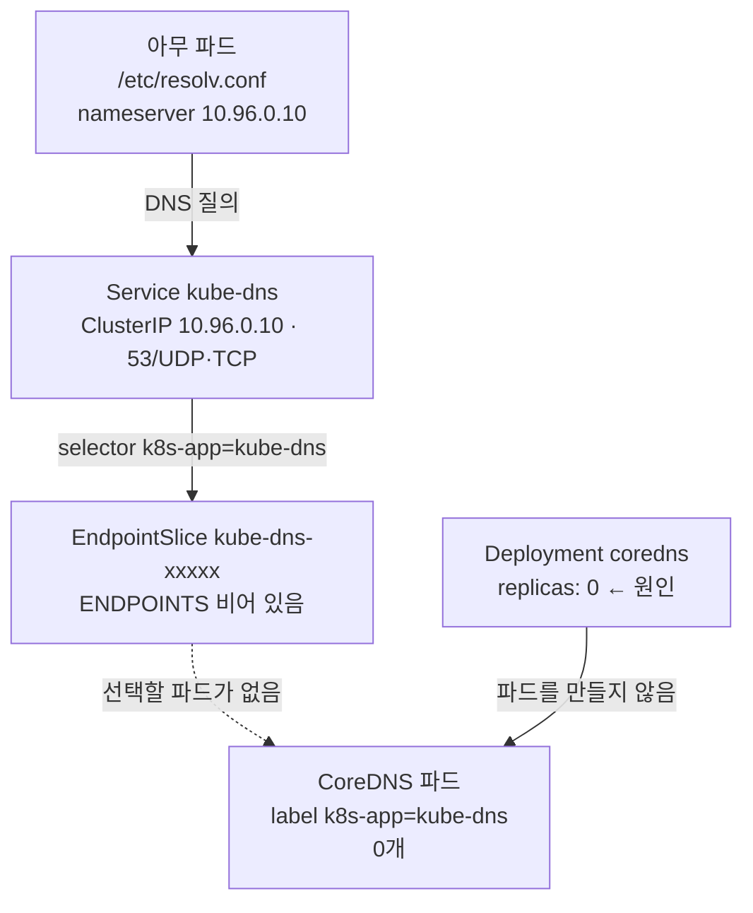

# q16 — Cluster DNS stopped working · 풀이

← 문제: **[question.md](question.md)**

## 문제 (해석)

**원문**

> In cluster `k8s-c1`, pods can no longer resolve any DNS name, not even `kubernetes.default`.
> Connections to pod IP addresses still work.
>
> 1. Find out why cluster DNS does not answer. Start from Service `kube-dns` in namespace
>    `kube-system` and its EndpointSlice.
> 2. Fix the problem so that cluster DNS runs with `2` replicas again.
> 3. Write the kind and name of the object you had to fix, in the form `<kind>/<name>` (for example
>    `daemonset/foo`), to `/opt/course/e16/cause.txt`.
> 4. From a temporary `busybox:1.36` pod, confirm that
>    `nslookup kubernetes.default.svc.cluster.local` succeeds.

**해석**

`k8s-c1` 클러스터에서 파드들이 `kubernetes.default` 를 포함해 어떤 DNS 이름도 해석하지 못한다. 파드
IP 주소로의 연결은 여전히 동작한다.

1. 클러스터 DNS가 응답하지 않는 이유를 찾는다. `kube-system` 네임스페이스의 Service `kube-dns` 와 그
   EndpointSlice에서 시작한다.
2. 클러스터 DNS가 다시 레플리카 `2` 로 동작하도록 고친다.
3. 고쳐야 했던 오브젝트의 kind와 이름을 `<kind>/<name>` 형식(예: `daemonset/foo`)으로
   `/opt/course/e16/cause.txt` 에 쓴다.
4. 임시 `busybox:1.36` 파드에서 `nslookup kubernetes.default.svc.cluster.local` 이 성공하는지 확인한다.

## 모범 풀이

**이름 세 개가 다릅니다** — Service는 `kube-dns`, 실제로 도는 것은 Deployment `coredns`, 파드 레이블은
`k8s-app=kube-dns` 입니다. 옛 kube-dns와의 호환을 위해 Service 이름과 레이블을 유지한 것입니다.

**1) Service → EndpointSlice → 파드 → Deployment 순서로 내려갑니다**

```bash
kubectl -n kube-system get svc kube-dns
# NAME       TYPE        CLUSTER-IP   EXTERNAL-IP   PORT(S)                  AGE
# kube-dns   ClusterIP   10.96.0.10   <none>        53/UDP,53/TCP,9153/TCP   90d
kubectl -n kube-system get endpointslice -l kubernetes.io/service-name=kube-dns
# NAME             ADDRESSTYPE   PORTS     ENDPOINTS   AGE
# kube-dns-8xq2v   IPv4          <unset>   <unset>     90d       ← 엔드포인트가 하나도 없다
kubectl -n kube-system get pods -l k8s-app=kube-dns
# No resources found in kube-system namespace.
kubectl -n kube-system get deploy coredns
# NAME      READY   UP-TO-DATE   AVAILABLE   AGE
# coredns   0/0     0            0           90d                 ← 레플리카가 0
```

Service와 ClusterIP는 그대로라서 파드의 `/etc/resolv.conf`(`nameserver 10.96.0.10`)는 정상이지만, 그
뒤에서 응답할 CoreDNS 파드가 없으므로 모든 조회가 실패합니다. 파드가 `CrashLoopBackOff` 나 `Pending`
이었다면 로그와 이벤트를 봐야 했겠지만, 파드가 **아예 없고** Deployment가 `0/0` 이면 원인은 레플리카
수입니다.

**2~3) 복구와 기록**

```bash
kubectl -n kube-system scale deploy coredns --replicas=2
kubectl -n kube-system rollout status deploy coredns
mkdir -p /opt/course/e16
echo deployment/coredns > /opt/course/e16/cause.txt
```

### 그림 — 이름 세 개를 따라 내려가기



1. 파드의 DNS 질의는 `resolv.conf` 의 `nameserver`, 즉 Service `kube-dns` 의 ClusterIP 로 갑니다. Service 와 ClusterIP 는 멀쩡하므로 여기까지는 정상입니다.
2. Service 는 selector `k8s-app=kube-dns` 로 EndpointSlice 를 채우는데 엔드포인트가 비어 있습니다. 질의를 받아 줄 곳이 없으니 모든 이름 해석이 실패합니다.
3. 그 라벨의 파드를 찾으면 0개이고, 파드를 만드는 주인인 Deployment `coredns` 가 `0/0` 입니다. 맨 아래의 이 오브젝트를 `scale --replicas=2` 로 고치면 위쪽이 차례로 채워집니다.
4. 파드 IP 로의 연결이 된다는 문제 조건은 CNI·라우팅이 정상이라는 뜻입니다. 그래서 네트워크가 아니라 DNS 경로만 따라가면 됩니다.

## 검증

```bash
kubectl -n kube-system get pods -l k8s-app=kube-dns        # 2개, 1/1 Running
kubectl -n kube-system get endpointslice -l kubernetes.io/service-name=kube-dns
# ENDPOINTS 에 CoreDNS 파드 IP 두 개
kubectl run dnstest --rm -it --restart=Never --image=busybox:1.36 -- nslookup kubernetes.default.svc.cluster.local
# Server:    10.96.0.10
# Address:   10.96.0.10:53
#
# Name:      kubernetes.default.svc.cluster.local
# Address:   10.96.0.1
cat /opt/course/e16/cause.txt                              # deployment/coredns
```

busybox 의 `nslookup` 은 점이 든 이름에 search 도메인을 붙이지 않습니다. 그래서 `nslookup kubernetes.default` 는
CoreDNS 가 정상이어도 NXDOMAIN 이 나오므로 FQDN 으로 확인합니다. 파드 안의 일반 프로그램(libc 리졸버)은
search 를 적용하므로, 문제 설명처럼 `kubernetes.default` 로도 해석됩니다.

## 오답 원인 / 배운 점

- **왜 틀렸나**:
- **기억할 것**: DNS 장애는 `kube-dns` Service → EndpointSlice(`-l kubernetes.io/service-name=kube-dns`) → `k8s-app=kube-dns` 파드 → Deployment `coredns` 순서로 내려간다.
- **헷갈리는 지점**: EndpointSlice가 비는 이유는 "파드가 없음"(레플리카 0)과 "파드는 있지만 Ready가 아님"(CrashLoop, Pending) 두 가지이고, `kubectl get pods` 한 번으로 갈립니다. Deployment를 지우고 다시 만들 필요 없이 `kubectl scale` 한 줄이면 됩니다.

## 참고 문서

- 검색어: `debugging dns resolution`
- https://kubernetes.io/docs/tasks/administer-cluster/dns-debugging-resolution/
- https://kubernetes.io/docs/concepts/services-networking/dns-pod-service/

---

[↑ 문항 목록](../README.md) · [← 문제로](question.md) · [다음 문제 q17 →](../q17_top_node_and_containers/question.md)
