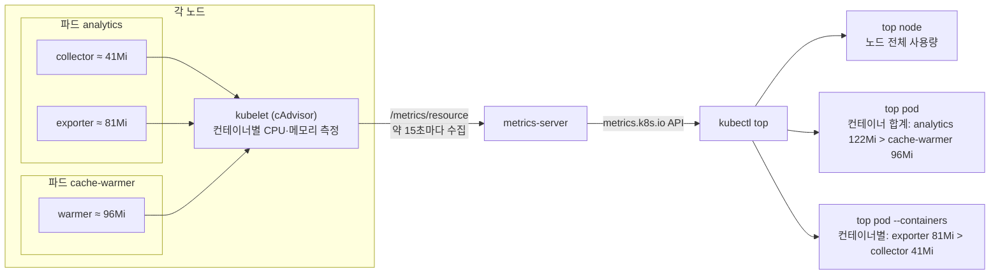

# q17 — Analyse resource usage per node and container · 풀이

← 문제: **[question.md](question.md)**

## 문제 (해석)

**원문**

> metrics-server is installed and working in cluster `k8s-c1`.
>
> 1. Write the name of the node that currently uses the most CPU to `/opt/course/e17/node.txt`.
> 2. Pod `analytics` in namespace `monitoring` has two containers, `collector` and `exporter`. Write
>    the name of the container that currently uses more memory to `/opt/course/e17/container.txt`.
> 3. Write the name of the pod in namespace `monitoring` that currently uses the most memory to
>    `/opt/course/e17/pod.txt`.

**해석**

`k8s-c1` 클러스터에는 metrics-server가 설치되어 정상 동작 중이다.

1. 현재 CPU를 가장 많이 쓰는 노드의 이름을 `/opt/course/e17/node.txt` 에 쓴다.
2. `monitoring` 네임스페이스의 Pod `analytics` 에는 컨테이너 `collector` 와 `exporter` 가 있다. 현재
   메모리를 더 많이 쓰는 컨테이너의 이름을 `/opt/course/e17/container.txt` 에 쓴다.
3. `monitoring` 네임스페이스에서 현재 메모리를 가장 많이 쓰는 파드의 이름을 `/opt/course/e17/pod.txt`
   에 쓴다.

## 모범 풀이

`kubectl top` 은 metrics-server가 모은 **실제 사용량**을 보여 줍니다. `--sort-by=cpu|memory` 로
정렬하면 첫 줄이 답입니다.

```bash
mkdir -p /opt/course/e17
```

**1) 노드**

```bash
kubectl top node --sort-by=cpu
# NAME       CPU(cores)   CPU(%)   MEMORY(bytes)   MEMORY(%)
# worker01   612m         30%      1650Mi          43%
# cp01       245m         12%      1480Mi          38%
# worker02   98m          4%       990Mi           26%
kubectl top node --sort-by=cpu --no-headers | head -1 | awk '{print $1}' > /opt/course/e17/node.txt
```

**2) 컨테이너별** — `kubectl top pod` 은 기본으로 파드 합계만 보여 주므로 `--containers` 가 필요합니다.
`--containers` 출력은 컨테이너 단위로 정렬되지 않으므로, 두 줄을 눈으로 비교하거나 `sort -h` 로 MEMORY 열(4번째)을 정렬합니다.

```bash
kubectl -n monitoring top pod analytics --containers
# POD         NAME        CPU(cores)   MEMORY(bytes)
# analytics   collector   0m           41Mi
# analytics   exporter    0m           81Mi
kubectl -n monitoring top pod analytics --containers --no-headers \
  | sort -k4 -h | tail -1 | awk '{print $2}' > /opt/course/e17/container.txt
cat /opt/course/e17/container.txt                  # exporter
```

**3) 네임스페이스에서 메모리 1위 파드**

```bash
kubectl -n monitoring top pod --sort-by=memory
# NAME            CPU(cores)   MEMORY(bytes)
# analytics       0m           122Mi
# cache-warmer    0m           96Mi
kubectl -n monitoring top pod --sort-by=memory --no-headers | head -1 | awk '{print $1}' > /opt/course/e17/pod.txt
```

### 그림 — `kubectl top` 의 숫자는 어디서 오는가



1. kubelet 이 노드의 컨테이너마다 CPU 와 메모리(working set)를 잽니다. metrics-server 는 각 kubelet 에서 이 값을 짧은 주기로 모아 `metrics.k8s.io` API 로 내놓고, `kubectl top` 은 그 API 를 읽기만 합니다.
2. `top node` 는 노드 전체 사용량입니다. 시스템 데몬과 컨트롤 플레인 파드까지 포함되므로 컨트롤 플레인 노드가 1등일 수도 있습니다.
3. `top pod` 의 한 줄은 **그 파드 안 모든 컨테이너의 합계**입니다. 그래서 컨테이너 하나만 보면 가장 큰 `warmer`(96Mi)가 있어도, 컨테이너 두 개를 더한 `analytics`(122Mi)가 파드 순위 1등입니다. 3번 문항은 파드를 묻기 때문에 이 합계가 답입니다.
4. `top pod --containers` 는 합계를 컨테이너별로 나눠 보여 줍니다. 2번 문항처럼 컨테이너를 묻는 문항은 반드시 이 옵션으로 봅니다.

**`top` 은 사용량, `describe node` 는 예약량입니다.** `kubectl describe node` 의 `Allocated resources`
는 파드들의 **requests 합계**라서 "가장 많이 쓰는" 노드를 묻는 질문의 답이 아닙니다. metrics-server는
기본 15초 간격으로 수집하므로 값이 계속 조금씩 변합니다. 파일에는 조회한 시점의 결과를 적습니다.

## 검증

```bash
cat /opt/course/e17/node.txt /opt/course/e17/container.txt /opt/course/e17/pod.txt
# worker01        ← 클러스터마다 다르다
# exporter
# analytics
kubectl top node --sort-by=cpu | sed -n 2p                   # node.txt 와 같은 이름
kubectl -n monitoring top pod analytics --containers         # container.txt 쪽 MEMORY 가 더 크다
kubectl -n monitoring top pod --sort-by=memory | sed -n 2p   # pod.txt 와 같은 이름
```

## 오답 원인 / 배운 점

- **왜 틀렸나**:
- **기억할 것**: `kubectl top node|pod --sort-by=cpu|memory`, 컨테이너별은 `--containers`, 첫 줄만 뽑을 때는 `--no-headers | head -1`.
- **헷갈리는 지점**: 파드 합계에는 사이드카 같은 다른 컨테이너의 사용량도 더해져 있으니, 컨테이너를 묻는 문항은 반드시 `--containers` 로 봅니다. `kubectl top` 이 `Metrics API not available` 을 내면 metrics-server 자체의 문제(B-q13)이고, 이 문제의 상황은 아닙니다.

## 참고 문서

- 검색어: `resource metrics pipeline`, `kubectl top`
- https://kubernetes.io/docs/tasks/debug/debug-cluster/resource-metrics-pipeline/
- https://kubernetes.io/docs/reference/kubectl/generated/kubectl_top/

---

[↑ 문항 목록](../README.md) · [← 문제로](question.md)
