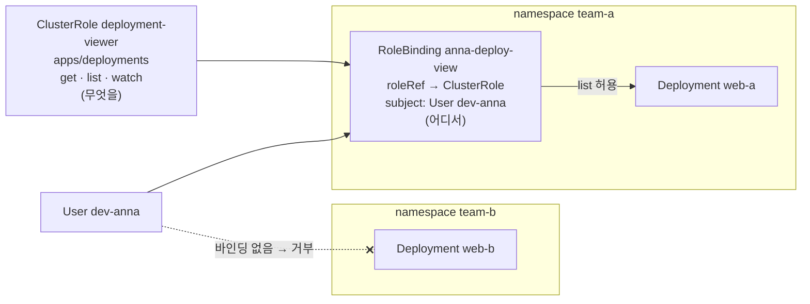

# q02 — Reuse a ClusterRole inside one namespace · 풀이

← 문제: **[question.md](question.md)**

## 문제 (해석)

**원문**

> User `dev-anna` needs read-only access to Deployments, but only in namespace `team-a`.
> Namespaces `team-a` and `team-b` already exist. The permissions must be defined once, at
> cluster level, so that they can be reused for other namespaces later.
>
> 1. Create ClusterRole `deployment-viewer` that allows the verbs `get`, `list` and `watch`
>    on `deployments` in API group `apps`.
> 2. Grant `deployment-viewer` to user `dev-anna` **only in namespace `team-a`**, using a
>    binding named `anna-deploy-view`.
> 3. Verify with `kubectl auth can-i ... --as=dev-anna` that `dev-anna` can list Deployments
>    in `team-a`, but not in `team-b` and not across all namespaces.

**해석**

사용자 `dev-anna` 는 Deployment 읽기 권한이 필요하지만 네임스페이스 `team-a` 에서만이다. 네임스페이스
`team-a` 와 `team-b` 는 이미 있다. 권한은 나중에 다른 네임스페이스에도 재사용할 수 있도록 클러스터
수준에서 한 번만 정의해야 한다.

1. API 그룹 `apps` 의 `deployments` 에 대해 동사 `get`, `list`, `watch` 를 허용하는 ClusterRole
   `deployment-viewer` 를 만든다.
2. 이름이 `anna-deploy-view` 인 바인딩으로 `deployment-viewer` 를 사용자 `dev-anna` 에게
   **네임스페이스 `team-a` 에서만** 부여한다.
3. `kubectl auth can-i ... --as=dev-anna` 로 `dev-anna` 가 `team-a` 의 Deployment 는 나열할 수 있지만
   `team-b` 와 전체 네임스페이스에서는 나열할 수 없음을 확인한다.

## 모범 풀이

```bash
kubectl create clusterrole deployment-viewer --verb=get,list,watch --resource=deployments.apps
kubectl -n team-a create rolebinding anna-deploy-view \
  --clusterrole=deployment-viewer --user=dev-anna
```

만들어진 바인딩입니다. **종류는 RoleBinding 인데 `roleRef` 가 ClusterRole 을 가리키는 것**이 핵심입니다.

```yaml
apiVersion: rbac.authorization.k8s.io/v1
kind: RoleBinding
metadata:
  name: anna-deploy-view
  namespace: team-a              # 권한이 적용되는 범위는 이 네임스페이스뿐
roleRef:
  apiGroup: rbac.authorization.k8s.io
  kind: ClusterRole
  name: deployment-viewer
subjects:
- apiGroup: rbac.authorization.k8s.io
  kind: User
  name: dev-anna
```

| 바인딩 | 참조하는 역할 | 권한이 적용되는 범위 |
|---|---|---|
| RoleBinding | Role | RoleBinding 의 네임스페이스 |
| RoleBinding | ClusterRole | **RoleBinding 의 네임스페이스만** — ClusterRole 을 권한 묶음으로 재사용 |
| ClusterRoleBinding | ClusterRole | 모든 네임스페이스 (+ 노드 같은 클러스터 범위 리소스) |

ClusterRole 은 "무엇을 할 수 있나"만 정의하고 "어디서"는 바인딩이 정합니다. 나중에 `team-c` 에도 같은
권한이 필요하면 ClusterRole 은 그대로 두고 `team-c` 에 RoleBinding 하나만 더 만들면 됩니다. 여기서
ClusterRoleBinding 을 쓰면 `dev-anna` 가 모든 네임스페이스의 Deployment 를 보게 되어 조건을 어깁니다.

### 그림 — 권한 정의와 적용 범위는 따로 정한다



1. ClusterRole 은 클러스터 범위 오브젝트이지만 "무엇을 할 수 있나"만 정의합니다. 혼자서는 아무에게도 권한을 주지 않습니다.
2. RoleBinding 은 `team-a` 안에 있고, 그 `roleRef` 가 ClusterRole 을 가리킵니다. 권한이 적용되는 범위는 바인딩이 있는 네임스페이스, 즉 `team-a` 뿐입니다.
3. `team-b` 에는 바인딩이 없으므로 `dev-anna` 의 요청은 거부됩니다. `-A`(모든 네임스페이스)로 나열하려면 클러스터 범위 권한이 필요하므로 이것도 `no` 입니다.
4. 같은 권한을 `team-c` 에 주려면 ClusterRole 은 그대로 두고 `team-c` 에 RoleBinding 하나만 더 만듭니다.

## 검증

```bash
kubectl auth can-i list deployments -n team-a --as=dev-anna      # yes
kubectl auth can-i list deployments -n team-b --as=dev-anna      # no
kubectl auth can-i list deployments -A --as=dev-anna             # no
kubectl auth can-i delete deployments -n team-a --as=dev-anna    # no — 읽기 전용
kubectl auth can-i --list -n team-a --as=dev-anna | grep deployments
# deployments.apps   []   []   [get list watch]
kubectl -n team-a get rolebinding anna-deploy-view -o wide
# NAME               ROLE                            AGE   USERS      GROUPS   SERVICEACCOUNTS
# anna-deploy-view   ClusterRole/deployment-viewer   20s   dev-anna
```

## 오답 원인 / 배운 점

- **왜 틀렸나**:
- **기억할 것**: RoleBinding + ClusterRole = 그 네임스페이스 안에서만 쓰는 재사용 권한. ClusterRoleBinding 은 모든 네임스페이스에 적용된다.
- **헷갈리는 지점**: 바인딩의 `roleRef` 는 만든 뒤 바꿀 수 없습니다. 잘못 만들었으면 지우고 다시 만듭니다. 그리고 쿠버네티스에는 User 오브젝트가 없으므로 `dev-anna` 를 따로 만들 필요가 없습니다. 인증된 사용자 이름(예: 클라이언트 인증서의 CN)이 `--user` 에 적은 이름과 같으면 권한이 적용됩니다.

## 참고 문서

- 검색어: `using rbac authorization`
- https://kubernetes.io/docs/reference/access-authn-authz/rbac/

## 복습 기록

| 날짜 | 결과 | 메모 |
|---|---|---|
|  |  |  |
