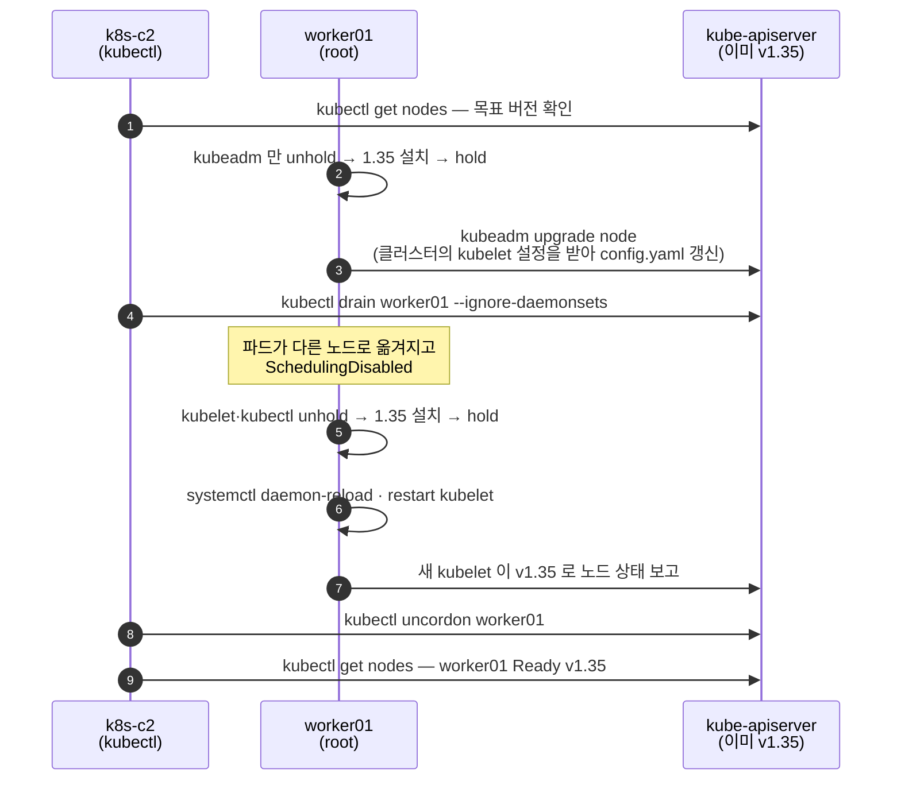

# q03 — Upgrade one worker node with kubeadm · 풀이

← 문제: **[question.md](question.md)**

## 문제 (해석)

**원문**

> The control plane of cluster `k8s-c2` already runs Kubernetes v1.35.x, but node `worker01`
> still runs v1.34. On `worker01` the apt repository already points to the Kubernetes v1.35
> packages and `apt update` has already been run. Run `kubectl` commands from `k8s-c2`.
>
> 1. On `worker01`, upgrade `kubeadm` to exactly the version the control plane runs, then
>    run the `kubeadm` upgrade step for a worker node.
> 2. Drain `worker01`. Then upgrade `kubelet` and `kubectl` on `worker01` to the same
>    version and restart the kubelet.
> 3. Make `worker01` schedulable again and confirm that `kubectl get nodes` shows it `Ready`
>    with the new version.

**해석**

클러스터 `k8s-c2` 의 컨트롤 플레인은 이미 Kubernetes v1.35.x 로 동작하지만, 노드 `worker01` 은 아직
v1.34 다. `worker01` 의 apt 저장소는 이미 v1.35 패키지를 가리키고 `apt update` 도 실행되어 있다.
`kubectl` 명령은 `k8s-c2` 에서 실행한다.

1. `worker01` 에서 `kubeadm` 을 컨트롤 플레인과 정확히 같은 버전으로 올린 뒤, 워커 노드용 `kubeadm`
   업그레이드 단계를 실행한다.
2. `worker01` 을 drain 한다. 그다음 `worker01` 의 `kubelet` 과 `kubectl` 을 같은 버전으로 올리고
   kubelet 을 재시작한다.
3. `worker01` 을 다시 스케줄 가능하게 만들고, `kubectl get nodes` 에서 새 버전으로 `Ready` 인지 확인한다.

## 모범 풀이

`kubectl` 은 `k8s-c2` 에서, `apt`·`kubeadm`·`systemctl` 은 `worker01` 에서 root 로 실행합니다.
아래 버전 `1.35.2` 는 예시이므로 실제 컨트롤 플레인 버전으로 바꿉니다.

```bash
# k8s-c2 — 목표 버전 확인
kubectl get nodes
# NAME       STATUS   ROLES           VERSION
# cp01       Ready    control-plane   v1.35.2
# worker01   Ready    <none>          v1.34.4
```

```bash
# worker01 — 1) kubeadm 을 먼저 올리고 upgrade node
apt-cache madison kubeadm | head -3        # 1.35.2-1.1 같은 패키지 버전 문자열 확인
apt-mark unhold kubeadm
apt-get install -y kubeadm=1.35.2-1.1
apt-mark hold kubeadm
kubeadm version -o short                   # v1.35.2
kubeadm upgrade node                       # 워커는 apply 가 아니라 node
```

```bash
# k8s-c2 — 2) drain
kubectl drain worker01 --ignore-daemonsets   # emptyDir 을 쓰는 파드가 있으면 --delete-emptydir-data 추가
```

```bash
# worker01 — 2) kubelet·kubectl 교체 후 재시작
apt-mark unhold kubelet kubectl
apt-get install -y kubelet=1.35.2-1.1 kubectl=1.35.2-1.1
apt-mark hold kubelet kubectl
systemctl daemon-reload                    # 새 패키지가 유닛·드롭인 파일을 바꿨을 수 있다
systemctl restart kubelet
```

```bash
# k8s-c2 — 3) uncordon
kubectl uncordon worker01
```

**왜 `upgrade node` 인가.** `kubeadm upgrade apply` 는 컨트롤 플레인 정적 파드, 클러스터 설정,
CoreDNS·kube-proxy 애드온을 올리는 작업이라 **첫 번째 컨트롤 플레인 노드에서 한 번만** 실행하고, 이
문제에서는 이미 끝났습니다. 워커에는 올릴 컨트롤 플레인도 `admin.conf` 도 없습니다. 워커에서
`kubeadm upgrade node` 는 클러스터에 저장된 kubelet 설정을 받아 `/var/lib/kubelet/config.yaml` 을 새
버전에 맞게 갱신합니다. 실제 버전을 바꾸는 것은 그다음의 kubelet 패키지 교체와 재시작입니다.

**왜 hold/unhold 인가.** 설치 가이드는 세 패키지를 `apt-mark hold` 로 고정합니다. `apt upgrade` 같은
일상 업데이트가 쿠버네티스 버전을 모르게 올리지 못하게 하려는 것입니다. 그래서 올릴 때는 `unhold` →
설치 → 다시 `hold` 입니다. hold 된 채로 `apt-get install -y kubeadm=...` 을 하면
`Held packages were changed and -y was used without --allow-change-held-packages` 로 실패합니다.

### 그림 — 어느 호스트에서 무엇을 하나



1. `kubectl` 은 워커에 kubeconfig 가 없으니 작업 호스트(`k8s-c2`)에서, 패키지와 `kubeadm`·`systemctl` 은 `worker01` 에서 root 로 실행합니다.
2. 워커의 `kubeadm upgrade node` 는 바이너리를 바꾸지 않습니다. 클러스터에 저장된 kubelet 설정을 받아 노드의 설정 파일만 새 버전에 맞춥니다. 그래서 drain 전에 해도 파드에 영향이 없습니다.
3. 파드가 실제로 영향을 받는 것은 kubelet 재시작이므로, 그 직전에 drain 하고 끝난 뒤 uncordon 합니다.
4. `kubectl get nodes` 의 VERSION 은 kubelet 이 보고하는 값입니다. kubelet 재시작 전에는 kubeadm 을 올려도 바뀌지 않습니다.

## 검증

```bash
kubectl get nodes                          # (k8s-c2)
# cp01       Ready    control-plane   v1.35.2
# worker01   Ready    <none>          v1.35.2    ← SchedulingDisabled 가 없어야 한다
kubelet --version                          # (worker01) Kubernetes v1.35.2
apt-mark showhold                          # (worker01) kubeadm, kubectl, kubelet
```

## 오답 원인 / 배운 점

- **왜 틀렸나**:
- **기억할 것**: 워커 = kubeadm 교체 → `kubeadm upgrade node` → drain → kubelet·kubectl 교체 → daemon-reload·restart → uncordon. 각 패키지는 unhold → 설치 → hold.
- **헷갈리는 지점**: `kubeadm` 만 올리고 kubelet 을 빼먹으면 `kubectl get nodes` 의 VERSION 은 그대로입니다 — 이 열은 kubelet 버전입니다. 그리고 kubelet 은 API server 보다 새 버전일 수 없으므로(오래된 쪽은 3개 마이너까지 허용) 항상 컨트롤 플레인을 먼저, 워커를 나중에 올립니다.

## 참고 문서

- 검색어: `upgrading linux nodes`
- https://kubernetes.io/docs/tasks/administer-cluster/kubeadm/upgrading-linux-nodes/
- https://kubernetes.io/docs/tasks/administer-cluster/kubeadm/kubeadm-upgrade/

---

[↑ 문항 목록](../README.md) · [← 문제로](question.md) · [다음 문제 q04 →](../q04_extension_interfaces_inventory/question.md)
