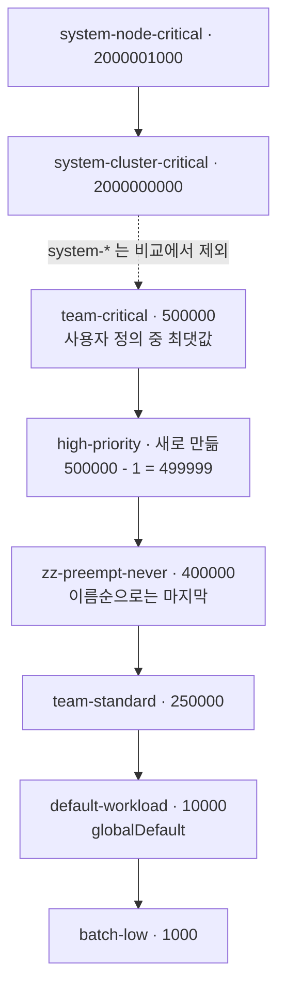
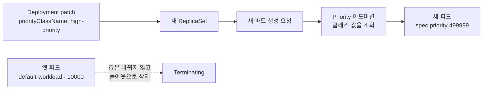

# q05 — Create a PriorityClass relative to existing ones · 풀이

← 문제: **[question.md](question.md)**

## 문제 (해석)

**원문**

> Deployment `busybox-logger` in namespace `priority` needs a high priority, just below the
> most important existing user workload. Several user-defined PriorityClasses already exist
> in the cluster.
>
> 1. Find the highest `value` among the existing user-defined PriorityClasses (ignore the
>    built-in `system-*` classes). Create PriorityClass `high-priority` with a value exactly
>    one less than that. It must not be the global default.
> 2. Patch Deployment `busybox-logger` in namespace `priority` so that its Pods use
>    PriorityClass `high-priority`.
> 3. Confirm that the Deployment's new Pods have `spec.priority` equal to the value of
>    `high-priority`.

**해석**

네임스페이스 `priority` 의 Deployment `busybox-logger` 에 높은 우선순위가 필요하다. 다만 이미 있는 가장
중요한 사용자 워크로드보다는 바로 아래여야 한다. 클러스터에는 사용자 정의 PriorityClass 가 이미 여러 개 있다.

1. 이미 있는 사용자 정의 PriorityClass 중 가장 큰 `value` 를 찾는다(내장 `system-*` 클래스는 제외).
   그보다 정확히 1 작은 값으로 PriorityClass `high-priority` 를 만든다. global default 가 아니어야 한다.
2. 네임스페이스 `priority` 의 Deployment `busybox-logger` 를 patch 해서 그 파드들이 PriorityClass
   `high-priority` 를 쓰게 한다.
3. Deployment 의 새 파드들의 `spec.priority` 가 `high-priority` 의 값과 같은지 확인한다.

## 모범 풀이

**1) 기존 최댓값 찾기 — `system-*` 는 제외**

```bash
kubectl get priorityclass --sort-by=.value
# NAME                      VALUE        GLOBAL-DEFAULT   AGE
# batch-low                 1000         false            ...     (예시)
# team-critical             500000       false            ...
# system-cluster-critical   2000000000   false            ...
# system-node-critical      2000001000   false            ...

kubectl get pc -o jsonpath='{range .items[*]}{.metadata.name}{" "}{.value}{"\n"}{end}' \
  | grep -v '^system-' | sort -k2 -n | tail -1
# team-critical 500000          → high-priority = 499999
```

```bash
kubectl create priorityclass high-priority --value=499999    # --global-default 는 기본 false
```

**2) Deployment 에 연결**

```bash
kubectl -n priority patch deploy busybox-logger \
  -p '{"spec":{"template":{"spec":{"priorityClassName":"high-priority"}}}}'
kubectl -n priority rollout status deploy busybox-logger
```

**핵심 — 파드의 우선순위는 만들어질 때 한 번 정해집니다.** Priority 어드미션 컨트롤러가 파드 생성
시점에 `priorityClassName` 을 보고 그 클래스의 값을 `spec.priority` 에 채웁니다. 이미 실행 중인 파드의
우선순위는 바뀌지 않습니다. 그래서 파드 템플릿을 바꿔야 하고, 템플릿이 바뀌면 Deployment 가 새
ReplicaSet 으로 롤아웃하면서 새 값을 가진 파드를 만듭니다. `spec.priority` 를 직접 쓰는 것이 아니라
`priorityClassName` 만 지정하는 이유입니다.

`globalDefault: true` 로 만들면 `priorityClassName` 이 없는 **클러스터의 모든 새 파드**가 이 값을 받게
되므로, 문제처럼 한 워크로드용 클래스는 반드시 `false` 로 둡니다.

### 그림 1 — 값 순서와 비교 대상



1. `--sort-by=.value` 로 보면 맨 위는 `system-*` 두 개입니다. 문제는 이 둘을 빼라고 했으므로 그 아래 `team-critical`(500000)이 기준입니다.
2. `high-priority` 는 기준보다 정확히 1 작은 `499999` 이고, 순서상 `team-critical` 과 `zz-preempt-never` 사이에 들어갑니다.
3. 이름순 마지막인 `zz-preempt-never` 나 globalDefault 인 `default-workload` 는 최댓값이 아닙니다. 둘 다 눈에 띄게 넣어 둔 함정입니다.

### 그림 2 — 파드의 `spec.priority` 가 채워지는 시점



1. 파드 템플릿에 `priorityClassName` 을 넣으면 템플릿이 바뀌므로 새 ReplicaSet 이 만들어집니다.
2. 새 파드가 만들어질 때 Priority 어드미션 컨트롤러가 클래스 값을 찾아 `spec.priority` 에 적습니다. 그래서 `spec.priority` 를 직접 쓰지 않습니다.
3. 옛 파드의 값은 그대로 `10000` 이고, 롤아웃이 끝나면서 지워집니다. 검증할 때 새 파드를 봐야 하는 이유입니다.

## 검증

```bash
kubectl get pc high-priority
# NAME            VALUE    GLOBAL-DEFAULT   AGE
# high-priority   499999   false            1m
kubectl -n priority get pods \
  -o custom-columns=NAME:.metadata.name,CLASS:.spec.priorityClassName,PRIORITY:.spec.priority
# busybox-logger-7c9d6b8f5-abcde   high-priority   499999
```

## 오답 원인 / 배운 점

- **왜 틀렸나**:
- **기억할 것**: 최댓값은 `system-*` 를 빼고 구한다. 파드에는 `priorityClassName` 만 주고, `spec.priority` 는 어드미션이 채운다.
- **헷갈리는 지점**: PriorityClass 는 네임스페이스가 없는 클러스터 범위 오브젝트라 `-n` 을 붙여도 의미가 없습니다. 롤아웃 직후에는 Terminating 중인 옛 파드가 `<none>` / `0` 으로 잠깐 보일 수 있으니 새 파드(AGE 가 짧은 것)를 확인합니다.

## 참고 문서

- 검색어: `pod priority preemption`
- https://kubernetes.io/docs/concepts/scheduling-eviction/pod-priority-preemption/

## 복습 기록

| 날짜 | 결과 | 메모 |
|---|---|---|
|  |  |  |
