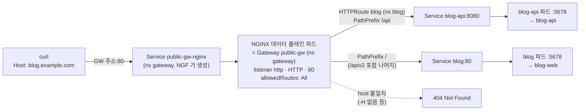
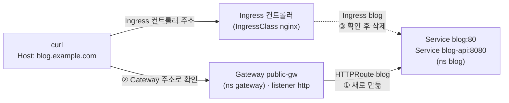

# q08 — Move an HTTP Ingress to an HTTPRoute · 풀이

← 문제: **[question.md](question.md)**

## 문제 (해석)

네임스페이스 `blog` 의 Ingress `blog` 는 호스트 `blog.example.com` 을 공개한다. 경로 `/` 는 Service `blog`
포트 `80` 으로, 경로 `/api` 는 Service `blog-api` 포트 `8080` 으로 간다. 플랫폼 팀은 네임스페이스
`gateway` 에서 Gateway `public-gw` 를 운영한다. 그 listener `http`(protocol HTTP, 포트 80)는 모든
네임스페이스의 route 를 받아들인다. Service `blog` 는 모든 요청에 `blog-web` 으로, Service `blog-api` 는
모든 요청에 `blog-api` 로 응답한다.

1. 네임스페이스 `blog` 에 HTTPRoute `blog` 를 만든다. 네임스페이스 `gateway` 의 Gateway `public-gw` 의
   listener `http` 에 붙이고, Ingress `blog` 와 같은 호스트 이름과 같은 두 경로 규칙을 준다.
2. Gateway `public-gw` 의 주소와 `Host: blog.example.com` 헤더로 `/` 는 `blog` 에, `/api` 는 `blog-api`
   에 도달하는지 확인한다.
3. 확인이 성공한 뒤 Ingress `blog` 를 지운다.

## 모범 풀이

**옮길 내용 확인** — `kubectl -n blog get ingress blog -o yaml` 의 `spec` 입니다.

```yaml
spec:
  ingressClassName: nginx
  rules:
  - host: blog.example.com
    http:
      paths:
      - path: /
        pathType: Prefix
        backend:
          service: {name: blog, port: {number: 80}}
      - path: /api
        pathType: Prefix
        backend:
          service: {name: blog-api, port: {number: 8080}}
```

| Ingress | HTTPRoute |
|---|---|
| `ingressClassName` (어느 컨트롤러가 처리하나) | `parentRefs` (어느 Gateway 의 어느 listener 에 붙나) |
| `rules[].host` | `hostnames[]` |
| `path` + `pathType: Prefix` | `matches[].path` (`type: PathPrefix`, `value`) |
| `pathType: Exact` | `type: Exact` |
| `backend.service.name` / `port.number` | `backendRefs[].name` / `port` (Service 의 port) |

```yaml
apiVersion: gateway.networking.k8s.io/v1
kind: HTTPRoute
metadata:
  name: blog
  namespace: blog
spec:
  parentRefs:
  - name: public-gw
    namespace: gateway          # Gateway 가 다른 네임스페이스라 필수
    sectionName: http           # listener 이름
  hostnames:
  - blog.example.com
  rules:
  - matches:
    - path: {type: PathPrefix, value: /}
    backendRefs:
    - {name: blog, port: 80}
  - matches:
    - path: {type: PathPrefix, value: /api}
    backendRefs:
    - {name: blog-api, port: 8080}
```

`kubectl apply -f blog-route.yaml` 로 적용합니다. 규칙 순서는 상관없습니다. Ingress 와 마찬가지로
**가장 긴 prefix 가 이기므로** `/api/...` 는 `blog-api` 로 갑니다. 다른 네임스페이스의 Gateway 에 붙을 수
있는 것은 listener 에 `allowedRoutes.namespaces.from: All` 이 있기 때문입니다. 기본값 `Same` 이었다면
route 가 `Accepted=False` 가 됩니다. backend 는 route 와 같은 네임스페이스에 있으므로 ReferenceGrant 는
필요 없습니다.

### 트래픽 흐름



1. 클라이언트가 Gateway 주소(`status.addresses`)의 80 포트로 요청을 보냅니다. NodePort 설치에서는 이 주소가
   `gateway` 의 `public-gw-nginx` Service ClusterIP 입니다. 클러스터 밖에서는 `<노드IP>:<NodePort>` 로 같은 Service 에 들어옵니다.
2. 요청은 Gateway `public-gw` 의 실체인 NGINX 파드에 도착하고, listener `http`(HTTP/80)가 받습니다. 이 listener 는
   `allowedRoutes.namespaces.from: All` 이라 `blog` 네임스페이스의 HTTPRoute 도 붙을 수 있습니다.
3. NGINX 는 Host 가 `blog.example.com` 인지 본 뒤 경로를 비교합니다. 가장 긴 prefix 가 이기므로 `/api`, `/api/posts` 는
   Service `blog-api` 포트 8080으로, 그 밖의 경로는 Service `blog` 포트 80으로 갑니다. Host 가 다르면 404를 직접 돌려줍니다.
4. 각 Service 가 `targetPort` 5678 의 파드로 요청을 넘기고 `blog-web` / `blog-api` 응답이 같은 길로 돌아옵니다.
   Ingress `blog` 는 트래픽 경로에 없고 규칙을 읽어 오는 원본일 뿐이라, HTTPRoute 확인이 끝난 뒤 지워도 응답은 그대로입니다.

### 옮기는 동안 입구가 두 개다



1. ① HTTPRoute 를 만들면 같은 Service 두 개로 가는 입구가 하나 더 생깁니다. 기존 Ingress 와 주소가 달라서 둘은 서로 부딪히지
   않고, 이 사이에도 기존 사용자는 Ingress 쪽으로 계속 들어옵니다.
2. ② 확인은 반드시 **Gateway 주소**로 합니다. Ingress 컨트롤러 주소로 curl 하면 HTTPRoute 가 틀려도 Ingress 가 대신
   응답해서 성공한 것처럼 보입니다.
3. ③ 두 경로가 Gateway 쪽에서 맞게 응답한 뒤에만 Ingress 를 지웁니다. 지우면 Ingress 컨트롤러 쪽 입구만 닫히고 Gateway 쪽
   응답은 그대로입니다. 순서를 바꾸면 HTTPRoute 에 실수가 있을 때 서비스가 끊깁니다.

## 검증

```bash
kubectl -n blog get httproute blog -o jsonpath='{range .status.parents[0].conditions[*]}{.type}={.status}{"\n"}{end}'
# Accepted=True
# ResolvedRefs=True
GW=$(kubectl -n gateway get gateway public-gw -o jsonpath='{.status.addresses[0].value}')
# 작업 호스트에서 $GW 에 닿지 않으면 임시 busybox:1.36 파드에서 wget -qO- --header 'Host: blog.example.com' 로 확인
curl -s -H 'Host: blog.example.com' http://$GW/            # blog-web
curl -s -H 'Host: blog.example.com' http://$GW/api         # blog-api
curl -s -H 'Host: blog.example.com' http://$GW/api/posts   # blog-api (prefix 매치)

kubectl -n blog delete ingress blog                        # 3) 확인이 끝난 뒤에만
curl -s -H 'Host: blog.example.com' http://$GW/api         # 여전히 blog-api
```

## 오답 원인 / 배운 점

- **왜 틀렸나**:
- **기억할 것**: Ingress 의 `host` → `hostnames`, `path`+`pathType` → `matches.path`, `backend.service` → `backendRefs`(Service 포트), 컨트롤러 선택 → `parentRefs`(+`namespace`, `sectionName`).
- **헷갈리는 지점**: `PathPrefix: /api` 는 `/api` 와 `/api/...` 에는 맞지만 `/apiv2` 에는 맞지 않습니다(경로 요소 단위 비교). 그리고 새 경로를 확인하기 전에 Ingress 를 먼저 지우면, HTTPRoute 에 실수가 있을 때 서비스가 그대로 끊깁니다.

## 참고 문서

- 검색어: `gateway api`, `migrating from ingress`
- https://kubernetes.io/docs/concepts/services-networking/gateway/
- https://gateway-api.sigs.k8s.io/guides/migrating-from-ingress/
- https://gateway-api.sigs.k8s.io/api-types/httproute/

## 복습 기록

| 날짜 | 결과 | 메모 |
|---|---|---|
|  |  |  |
