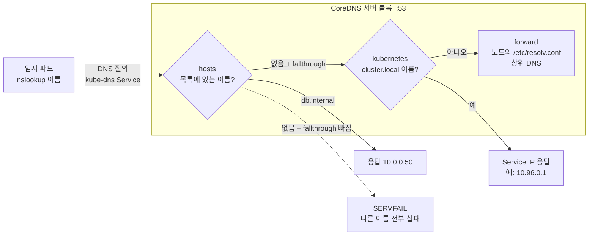

# q10 — Add a static DNS record with CoreDNS · 풀이

← 문제: **[question.md](question.md)**

## 문제 (해석)

**원문**

> Pods in the cluster must be able to resolve the name `db.internal` to `10.0.0.50`. The
> record must be served by the cluster DNS (CoreDNS); do not change the Pods' own
> `/etc/hosts`.
>
> 1. Back up ConfigMap `coredns` in namespace `kube-system` to
>    `/opt/course/f10/coredns-backup.yaml`.
> 2. Add a `hosts` entry to the Corefile in that ConfigMap so that `db.internal` resolves to
>    `10.0.0.50`, while every other name keeps resolving as before.
> 3. Make sure CoreDNS uses the new configuration. Then verify from a temporary
>    `busybox:1.36` Pod that `db.internal` resolves to `10.0.0.50` and that
>    `kubernetes.default.svc.cluster.local` still resolves.

**해석**

클러스터의 파드들이 이름 `db.internal` 을 `10.0.0.50` 으로 해석할 수 있어야 한다. 이 레코드는 클러스터
DNS(CoreDNS)가 제공해야 하며, 파드 자신의 `/etc/hosts` 는 바꾸지 않는다.

1. 네임스페이스 `kube-system` 의 ConfigMap `coredns` 를 `/opt/course/f10/coredns-backup.yaml` 에 백업한다.
2. 그 ConfigMap 의 Corefile 에 `hosts` 항목을 추가해 `db.internal` 이 `10.0.0.50` 으로 해석되게 하되,
   다른 모든 이름은 전과 같이 해석되어야 한다.
3. CoreDNS 가 새 설정을 쓰도록 한다. 그다음 임시 `busybox:1.36` 파드에서 `db.internal` 이 `10.0.0.50`
   으로 해석되고 `kubernetes.default.svc.cluster.local` 도 여전히 해석되는지 확인한다.

## 모범 풀이

**1) 백업부터** — Corefile 문법이 틀린 채로 CoreDNS 가 재시작되면 파드가 CrashLoopBackOff 가 되어 클러스터
DNS 전체가 멈춥니다. 되돌릴 원본을 먼저 남깁니다.

```bash
mkdir -p /opt/course/f10
kubectl -n kube-system get cm coredns -o yaml > /opt/course/f10/coredns-backup.yaml
kubectl -n kube-system edit cm coredns
```

**2) `.:53 { }` 블록 안에 `hosts` 추가** (나머지 줄은 그대로 둡니다)

```
.:53 {
    errors
    ...
    ready
    hosts {
       10.0.0.50 db.internal
       fallthrough
    }
    kubernetes cluster.local in-addr.arpa ip6.arpa {
       ...
    }
    forward . /etc/resolv.conf {
       ...
    }
    ...
    reload
    ...
}
```

플러그인의 실행 순서는 CoreDNS 빌드 때 정해져 있어서 블록 안에서 어느 줄에 쓰든 결과는 같습니다.
`hosts` 는 `kubernetes`, `forward` 보다 먼저 실행됩니다.

**핵심 — `fallthrough` 가 없으면 다른 이름이 전부 깨집니다.** 이 `hosts` 블록은 서버 블록의 영역 `.`
(모든 이름)을 맡습니다. `fallthrough` 가 없으면 목록에 없는 이름을 다음 플러그인으로 넘기지 않고 스스로
실패 응답(SERVFAIL)을 돌려주므로, `kubernetes.default.svc.cluster.local` 도 외부 도메인도 해석되지
않습니다. `fallthrough` 가 있으면 모르는 이름은 `kubernetes` → `forward` 로 넘어갑니다.

**3) 반영** — `reload` 플러그인이 바뀐 Corefile 을 다시 읽지만, ConfigMap 이 파드에 전파되기까지 1~2분이
걸릴 수 있습니다. 바로 반영하려면 재시작합니다.

```bash
kubectl -n kube-system rollout restart deploy coredns
kubectl -n kube-system rollout status deploy coredns
```

### 그림 1 — 질의가 CoreDNS 플러그인을 지나는 길



1. 파드의 DNS 질의는 `kube-dns` Service 를 거쳐 CoreDNS 파드로 갑니다. 플러그인은 Corefile 에 쓴 줄 순서가 아니라 빌드 때 정해진 순서로 실행되고, `hosts` 가 `kubernetes`·`forward` 보다 앞입니다.
2. `db.internal` 은 `hosts` 목록에 있으므로 바로 `10.0.0.50` 으로 응답합니다. 뒤 플러그인까지 가지 않습니다.
3. 목록에 없는 이름은 `fallthrough` 가 있을 때만 `kubernetes` 로 넘어갑니다. `kubernetes.default.svc.cluster.local` 은 여기서 Service IP 로 응답하고, 외부 이름은 `forward` 가 상위 DNS 에 물어봅니다.
4. `fallthrough` 를 빼면 점선처럼 `hosts` 가 목록에 없는 모든 이름에 실패 응답을 돌려줍니다. 문제 3번의 두 번째 확인이 이 실수를 잡아내는 장치입니다.

## 검증

```bash
kubectl run dnstest --rm -it --image=busybox:1.36 --restart=Never -- nslookup db.internal
# Name:	db.internal
# Address: 10.0.0.50
kubectl run dnstest --rm -it --image=busybox:1.36 --restart=Never -- nslookup kubernetes.default.svc.cluster.local
# Name:	kubernetes.default.svc.cluster.local
# Address: 10.96.0.1
kubectl -n kube-system get pods -l k8s-app=kube-dns       # 새 파드 Running, RESTARTS 0
kubectl -n kube-system logs -l k8s-app=kube-dns --tail=5  # 설정 오류 로그가 없어야 한다
```

busybox 의 `nslookup` 은 점(`.`)이 들어간 이름에는 search 도메인을 붙이지 않아 `nslookup kubernetes.default`
는 CoreDNS 가 정상이어도 NXDOMAIN 이 나올 수 있습니다. 그래서 FQDN 으로 확인합니다.

## 오답 원인 / 배운 점

- **왜 틀렸나**:
- **기억할 것**: `hosts { <IP> <이름> \n fallthrough }` 를 `.:53 { }` 안에 넣는다. `fallthrough` 를 빼면 나머지 DNS 가 모두 실패한다.
- **헷갈리는 지점**: 파드 spec 의 `hostAliases` 도 `/etc/hosts` 에 줄을 넣지만 그 파드 하나에만 적용됩니다. 클러스터 전체에 같은 이름이 필요하면 CoreDNS 에 넣습니다. 그리고 CoreDNS 의 Deployment 는 `coredns`, Service 는 `kube-dns`, 파드 라벨은 `k8s-app=kube-dns` 입니다.

## 참고 문서

- 검색어: `customizing dns service`
- https://kubernetes.io/docs/tasks/administer-cluster/dns-custom-nameservers/
- https://coredns.io/plugins/hosts/

---

[↑ 문항 목록](../README.md) · [← 문제로](question.md) · [다음 문제 q11 →](../q11_pv_reclaim_policy_patch/question.md)
