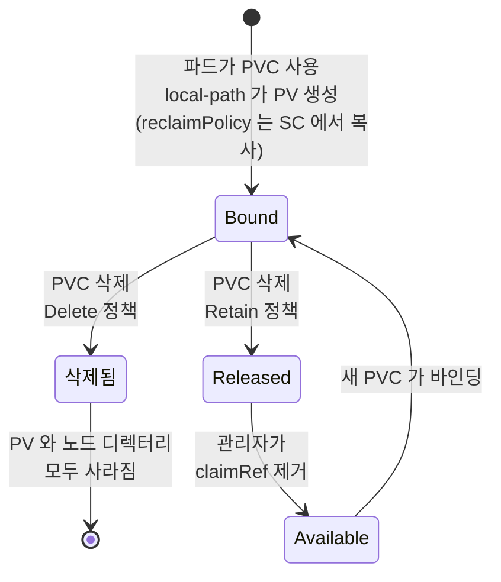

# q11 — Protect a dynamically provisioned volume · 풀이

← 문제: **[question.md](question.md)**

## 문제 (해석)

**원문**

> In namespace `db`, PVC `pg-data` is `Bound` to a PersistentVolume that was dynamically
> provisioned by a StorageClass with reclaim policy `Delete`. The data on that volume must
> survive even if the PVC is deleted by mistake.
>
> 1. Write the name of the PersistentVolume bound to PVC `pg-data` to
>    `/opt/course/f11/pv.txt`.
> 2. Change the reclaim policy of that PersistentVolume to `Retain`, without recreating the
>    PV, the PVC or the StorageClass.
> 3. Verify that `kubectl get pv` shows `Retain` for that volume and that `pg-data` is still
>    `Bound`.

**해석**

네임스페이스 `db` 의 PVC `pg-data` 는 reclaim policy 가 `Delete` 인 StorageClass 가 동적으로 프로비저닝한
PersistentVolume 에 `Bound` 되어 있다. PVC 가 실수로 지워지더라도 그 볼륨의 데이터는 살아남아야 한다.

1. PVC `pg-data` 에 바인딩된 PersistentVolume 의 이름을 `/opt/course/f11/pv.txt` 에 쓴다.
2. PV, PVC, StorageClass 를 다시 만들지 않고 그 PersistentVolume 의 reclaim policy 를 `Retain` 으로 바꾼다.
3. `kubectl get pv` 에서 그 볼륨이 `Retain` 으로 보이고 `pg-data` 가 여전히 `Bound` 인지 확인한다.

## 모범 풀이

```bash
mkdir -p /opt/course/f11
kubectl -n db get pvc pg-data                      # VOLUME 열에 PV 이름
kubectl -n db get pvc pg-data -o jsonpath='{.spec.volumeName}{"\n"}' > /opt/course/f11/pv.txt
PV=$(cat /opt/course/f11/pv.txt)                   # 예: pvc-6b1f0c2e-...  (동적 PV 는 pvc-<UID> 형식)

kubectl patch pv $PV -p '{"spec":{"persistentVolumeReclaimPolicy":"Retain"}}'
```

**핵심 — reclaim policy 는 PV 의 필드이고, PVC 가 지워질 때 PV 를 어떻게 할지 정합니다.**

| PVC 를 지우면 | 결과 |
|---|---|
| 변경 전 (`Delete`) | PV 와 실제 저장소(디스크·디렉터리)가 PVC 와 함께 삭제 — 데이터 소실 |
| 변경 후 (`Retain`) | PV 는 `Released` 상태로 남고 데이터 보존. 다른 PVC 에 자동으로 바인딩되지 않음 |

`Released` PV 를 다시 쓰려면 관리자가 데이터를 확인한 뒤 PV 의 `spec.claimRef` 를 지워 `Available` 로
만들고, 그다음 새 PVC 를 바인딩합니다(특정 PV 에 고정하려면 새 PVC 에 `spec.volumeName`). `claimRef` 를
그대로 두고 새 PVC 에 `volumeName` 만 지정하면 안 됩니다 — `claimRef` 에 남은 옛 PVC 의 UID 가 새 PVC 와
달라서 "already bound to a different claim" 이벤트와 함께 새 PVC 가 `Pending` 에 머뭅니다.

```bash
kubectl patch pv $PV --type=json -p '[{"op":"remove","path":"/spec/claimRef"}]'    # Released → Available
```

**StorageClass 를 바꾸는 것은 답이 아닙니다.** StorageClass 의 `reclaimPolicy` 는 프로비저닝할 때 새 PV 에
**복사**될 뿐이라 이미 만들어진 PV 에는 영향이 없습니다. 게다가 StorageClass 의 `reclaimPolicy` 는 만든 뒤
수정할 수 없습니다. 그래서 기존 볼륨은 PV 를 하나씩 `kubectl patch pv` 로 바꿉니다.

### 그림 — reclaim policy 가 바꾸는 PVC 삭제 이후



1. 동적 프로비저닝 때 StorageClass 의 `reclaimPolicy`(`Delete`)가 새 PV 의 `persistentVolumeReclaimPolicy` 로 복사됩니다. 그 뒤로 둘은 따로 놉니다.
2. 정책이 `Delete` 인 채로 PVC 가 지워지면 프로비저너가 PV 와 실제 저장소를 함께 지웁니다. 문제에서 막으려는 경로입니다.
3. `kubectl patch pv` 로 `Retain` 으로 바꿔 두면 PVC 가 지워져도 PV 는 `Released` 로 남고 데이터도 남습니다.
4. `Released` PV 는 자동으로 다시 쓰이지 않습니다. 관리자가 `claimRef` 를 지워 `Available` 로 만들어야 새 PVC 가 바인딩됩니다.

## 검증

```bash
kubectl get pv $PV
# NAME           CAPACITY   ACCESS MODES   RECLAIM POLICY   STATUS   CLAIM        STORAGECLASS   ...
# pvc-6b1f0c2e   1Gi        RWO            Retain           Bound    db/pg-data   local-path     ...
kubectl -n db get pvc pg-data               # STATUS Bound (그대로)
kubectl get sc                              # 클래스의 RECLAIMPOLICY 는 여전히 Delete — 새 PV 에만 적용
cat /opt/course/f11/pv.txt
```

## 오답 원인 / 배운 점

- **왜 틀렸나**:
- **기억할 것**: 기존 볼륨 보호 = `kubectl patch pv <PV> -p '{"spec":{"persistentVolumeReclaimPolicy":"Retain"}}'`. PVC 가 아니라 PV 를 고친다.
- **헷갈리는 지점**: reclaim policy 는 PVC 가 아니라 PV 에 있습니다(PVC 에는 이 필드가 없습니다). 그리고 `Retain` 은 PVC 삭제로부터 데이터를 지킬 뿐 백업이 아닙니다. `Retain` PV 는 PV 오브젝트를 지워도 실제 저장소가 남으므로, 필요 없어지면 그 저장소를 직접 정리해야 합니다.

## 참고 문서

- 검색어: `change reclaim policy persistentvolume`
- https://kubernetes.io/docs/tasks/administer-cluster/change-pv-reclaim-policy/
- https://kubernetes.io/docs/concepts/storage/persistent-volumes/#reclaiming

---

[↑ 문항 목록](../README.md) · [← 문제로](question.md) · [다음 문제 q12 →](../q12_projected_volume/question.md)
