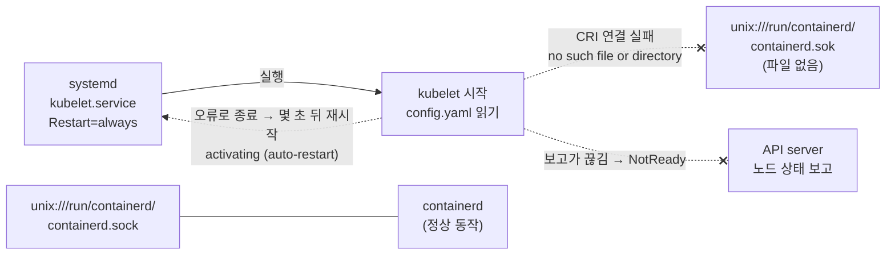

# q13 — Node NotReady after a kubelet config change · 풀이

← 문제: **[question.md](question.md)**

## 문제 (해석)

**원문**

> Node `worker02` became `NotReady` shortly after someone edited the kubelet configuration
> file `/var/lib/kubelet/config.yaml` on that node. containerd on `worker02` is running
> normally.
>
> 1. On `worker02`, find out why the kubelet does not stay running. Write the wrong
>    configuration value you found to `/opt/course/f13/cause.txt` on `worker02`.
> 2. Fix the configuration and restart the kubelet.
> 3. Confirm from `k8s-c1` that `worker02` is `Ready`.

**해석**

누군가 노드 `worker02` 의 kubelet 설정 파일 `/var/lib/kubelet/config.yaml` 을 고친 직후 `worker02` 가
`NotReady` 가 되었다. `worker02` 의 containerd 는 정상 동작 중이다.

1. `worker02` 에서 kubelet 이 계속 실행되지 못하는 이유를 찾는다. 찾아낸 잘못된 설정 값을 `worker02` 의
   `/opt/course/f13/cause.txt` 에 쓴다.
2. 설정을 고치고 kubelet 을 재시작한다.
3. `k8s-c1` 에서 `worker02` 가 `Ready` 인지 확인한다.

## 모범 풀이

**1) 상태 → 로그 → 설정 파일 순서로 좁힙니다**

```bash
# k8s-c1
kubectl get nodes                          # worker02   NotReady
ssh worker02
sudo -i
systemctl status kubelet
# Active: activating (auto-restart) (Result: exit-code)     ← 시작하자마자 죽고 재시작을 반복
journalctl -u kubelet -n 20 --no-pager | grep -i endpoint
# "command failed" err="failed to run Kubelet: validate service connection: validate CRI v1 runtime API
#  for endpoint \"unix:///run/containerd/containerd.sok\": ... dial unix /run/containerd/containerd.sok:
#  connect: no such file or directory"     (예)
grep containerRuntimeEndpoint /var/lib/kubelet/config.yaml
# containerRuntimeEndpoint: unix:///run/containerd/containerd.sok      ← .sock 이 아니라 .sok
ls -l /run/containerd/containerd.sock      # 실제 소켓은 여기 있다 (srw-rw----)
systemctl is-active containerd             # active — 런타임 자체는 정상

mkdir -p /opt/course/f13
awk '/containerRuntimeEndpoint/{print $2}' /var/lib/kubelet/config.yaml > /opt/course/f13/cause.txt
```

**2) 고치고 재시작**

```bash
sed -i 's#containerd\.sok#containerd.sock#' /var/lib/kubelet/config.yaml
grep containerRuntimeEndpoint /var/lib/kubelet/config.yaml
# containerRuntimeEndpoint: unix:///run/containerd/containerd.sock
systemctl restart kubelet
```

**핵심 — `activating (auto-restart)` 는 "kubelet 이 시작 직후 오류로 종료한다"는 뜻입니다.** 유닛에
`Restart=always` 가 있어 systemd 가 계속 다시 띄우지만 같은 오류로 또 죽습니다. 원인은 journal 의 마지막
오류 문장에 있습니다. 여기서는 kubelet 이 시작할 때 CRI 엔드포인트에 접속해 런타임 API 를 확인하는데,
오타 난 소켓 경로에 파일이 없어 `no such file or directory` 로 실패했습니다.

`daemon-reload` 는 필요 없습니다. `config.yaml` 은 kubelet 이 시작할 때 읽는 kubelet 자신의 설정
파일이고 systemd 는 이 파일을 모릅니다. `daemon-reload` 는 유닛 파일이나 드롭인(`kubelet.service.d/`)을
고쳤을 때만 필요합니다.

### 그림 — kubelet 이 시작하다 멈추는 곳



1. systemd 가 kubelet 을 띄우면 kubelet 은 먼저 `config.yaml` 을 읽고, `containerRuntimeEndpoint` 의 소켓으로 런타임(CRI)에 연결해 봅니다.
2. 경로가 `.sok` 로 틀려 그 파일이 없으므로 연결이 실패하고 kubelet 이 바로 종료됩니다. containerd 는 진짜 소켓 `.sock` 에서 정상으로 기다리고 있습니다.
3. `Restart=always` 때문에 systemd 가 계속 다시 띄우지만 같은 오류로 또 죽습니다. `systemctl status` 의 `activating (auto-restart)` 가 이 상태입니다.
4. kubelet 이 API server 에 상태를 보내지 못하니 컨트롤 플레인은 일정 시간 뒤 노드를 `NotReady` 로 표시합니다. `.sock` 으로 고치고 재시작하면 보고가 다시 시작되어 `Ready` 로 돌아옵니다.

## 검증

```bash
systemctl is-active kubelet                # (worker02) active
cat /opt/course/f13/cause.txt              # unix:///run/containerd/containerd.sok
exit; exit                                 # k8s-c1 로
kubectl get nodes                          # worker02   Ready  (수십 초 걸릴 수 있음)
```

## 오답 원인 / 배운 점

- **왜 틀렸나**:
- **기억할 것**: `systemctl status kubelet` → `journalctl -u kubelet -n 20 --no-pager` → 로그가 가리키는 설정 줄. `config.yaml` 만 고쳤으면 `systemctl restart kubelet` 만 하면 된다.
- **헷갈리는 지점**: 증상이 비슷해도 구분됩니다. kubelet 이 **죽고 재시작을 반복**하면(`activating (auto-restart)`) 설정 파일·플래그·런타임 연결 같은 시작 단계의 문제이고, kubelet 이 `active (running)` 인데 NotReady 면 kubelet 이 보고하는 노드 condition 메시지(예: CNI 미초기화)를 봐야 합니다.

## 참고 문서

- 검색어: `kubelet config file`, `troubleshooting clusters`
- https://kubernetes.io/docs/tasks/administer-cluster/kubelet-config-file/
- https://kubernetes.io/docs/tasks/debug/debug-cluster/

## 복습 기록

| 날짜 | 결과 | 메모 |
|---|---|---|
|  |  |  |
