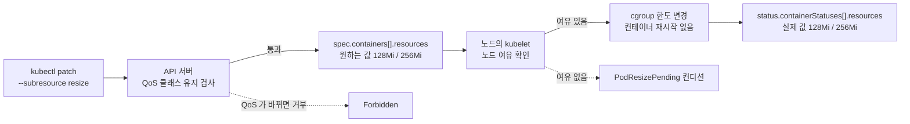

# q17 — Give a running Pod more memory without restarting it · 풀이

← 문제: **[question.md](question.md)**

## 문제 (해석)

**원문**

> In namespace `perf`, the standalone Pod `cache` (container `app`, image `nginx:1.27`) runs
> with a memory request of `64Mi` and a memory limit of `128Mi`. It is healthy but needs
> more memory headroom, and it must not be restarted or recreated. metrics-server is
> installed.
>
> 1. Write the current memory usage of container `app`, as reported by `kubectl top`, to
>    `/opt/course/f17/usage.txt`.
> 2. Raise the memory request of `app` to `128Mi` and its memory limit to `256Mi` without
>    deleting, recreating or restarting the Pod.
> 3. Verify that the Pod status reports the new memory request and limit for `app` and that
>    the container's `restartCount` did not change.

**해석**

네임스페이스 `perf` 의 단독 Pod `cache`(컨테이너 `app`, image `nginx:1.27`)는 메모리 request `64Mi`,
메모리 limit `128Mi` 로 실행 중이다. 정상이지만 메모리 여유가 더 필요하고, 재시작하거나 다시 만들면 안
된다. metrics-server 는 설치되어 있다.

1. `kubectl top` 이 보고하는 컨테이너 `app` 의 현재 메모리 사용량을 `/opt/course/f17/usage.txt` 에 쓴다.
2. 파드를 지우거나 다시 만들거나 재시작하지 않고 `app` 의 메모리 request 를 `128Mi`, 메모리 limit 을
   `256Mi` 로 올린다.
3. 파드 status 가 `app` 의 새 메모리 request 와 limit 을 보고하는지, 컨테이너의 `restartCount` 가 그대로인지
   확인한다.

## 모범 풀이

**1) 사용량과 기준값**

```bash
mkdir -p /opt/course/f17
kubectl -n perf top pod cache --containers
# POD     NAME   CPU(cores)   MEMORY(bytes)
# cache   app    0m           4Mi               (값은 예시)
kubectl -n perf top pod cache --containers --no-headers | awk '{print $4}' > /opt/course/f17/usage.txt
kubectl -n perf get pod cache -o jsonpath='{.status.containerStatuses[0].restartCount}{"\n"}'   # 0 — 기준값
```

**2) `resize` 서브리소스로 변경**

```bash
kubectl -n perf patch pod cache --subresource resize -p \
  '{"spec":{"containers":[{"name":"app","resources":{"requests":{"memory":"128Mi"},"limits":{"memory":"256Mi"}}}]}}'
```

**핵심 — 파드의 resources 는 `resize` 서브리소스로만 바꿀 수 있습니다.** In-place pod resize 는 v1.35 에서
GA 가 되었습니다. 서브리소스 없이 `kubectl edit pod` 나 `kubectl patch` 로 resources 를 바꾸면 예전처럼
`Forbidden: pod updates may not change fields other than ...` 로 거부됩니다. `kubectl edit pod cache
--subresource resize` 처럼 편집기로 고치는 것도 됩니다(`--subresource resize` 는 kubectl v1.32 이상). 컨테이너의 `resizePolicy`
기본값이 `NotRequired` 라서 kubelet 은 컨테이너를 재시작하지 않고 cgroup 한도만 바꿉니다(`RestartContainer`
로 지정한 리소스만 재시작).

- `spec` 의 resources 는 **원하는 값**, `status.containerStatuses[].resources` 는 **실제로 적용된 값**입니다.
  노드에 여유가 없으면 적용이 미뤄지고 파드에 `PodResizePending` 컨디션이 붙습니다.
- **QoS 클래스는 resize 로 바뀔 수 없습니다.** 이 파드는 request < limit 인 `Burstable` 이고 변경 후에도
  `Burstable` 이라 허용됩니다. QoS 클래스가 달라지는 resize(예: `Burstable` → `Guaranteed`)는 거부됩니다.

### 그림 — resize 요청이 적용되는 흐름



1. `resize` 서브리소스로 보낸 요청만 resources 변경이 허용됩니다. API 서버는 이때 QoS 클래스가 그대로인지 먼저 봅니다. 이 파드는 변경 전후 모두 `Burstable` 이라 통과합니다.
2. 통과하면 `spec` 의 값이 바로 바뀝니다. 이것은 원하는 값일 뿐, 아직 적용된 값은 아닙니다.
3. 노드의 kubelet 이 노드에 여유가 있는지 보고, 있으면 컨테이너를 재시작하지 않고 cgroup 메모리 한도만 바꿉니다. 메모리의 `resizePolicy` 기본값이 `NotRequired` 이기 때문입니다.
4. 적용이 끝나면 `status.containerStatuses[].resources` 가 새 값으로 바뀝니다. 문제 3번은 `spec` 이 아니라 이 `status` 를 확인하라는 뜻입니다. 여유가 없으면 `PodResizePending` 컨디션이 붙고 status 는 옛 값에 머뭅니다.

## 검증

```bash
kubectl -n perf get pod cache -o jsonpath=\
'{.status.containerStatuses[0].resources.requests.memory} {.status.containerStatuses[0].resources.limits.memory}{"\n"}'
# 128Mi 256Mi
kubectl -n perf get pod cache -o jsonpath='{.status.containerStatuses[0].restartCount}{"\n"}'   # 0 (그대로)
kubectl -n perf get pod cache -o jsonpath='{.status.qosClass}{"\n"}'                          # Burstable
kubectl -n perf get pod cache                         # AGE 가 그대로 — 새로 만들어지지 않음
cat /opt/course/f17/usage.txt                         # 4Mi
```

## 오답 원인 / 배운 점

- **왜 틀렸나**:
- **기억할 것**: 실행 중인 파드의 CPU·메모리 변경 = `kubectl patch pod <P> --subresource resize -p '{"spec":{"containers":[{"name":"<c>","resources":{...}}]}}'`. 적용 여부는 `status.containerStatuses[].resources` 로 본다.
- **헷갈리는 지점**: Deployment 가 관리하는 파드를 이렇게 resize 하면 그 파드만 바뀌고 파드 템플릿은 그대로라, 다음 롤아웃 때 원래 값으로 돌아갑니다. 영구적으로 바꾸려면 Deployment 의 템플릿을 고칩니다(이때는 파드가 새로 만들어집니다).

## 참고 문서

- 검색어: `resize container resources`
- https://kubernetes.io/docs/tasks/configure-pod-container/resize-container-resources/

## 복습 기록

| 날짜 | 결과 | 메모 |
|---|---|---|
|  |  |  |
